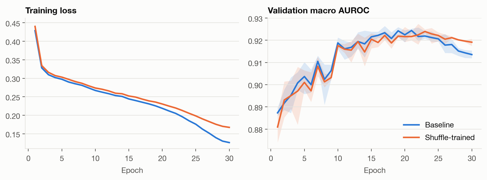
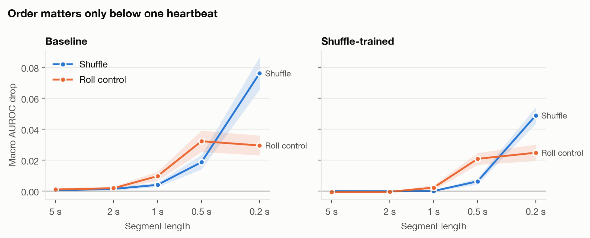
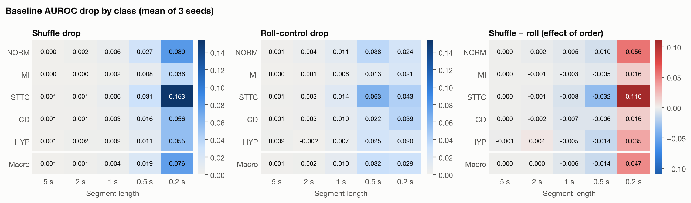
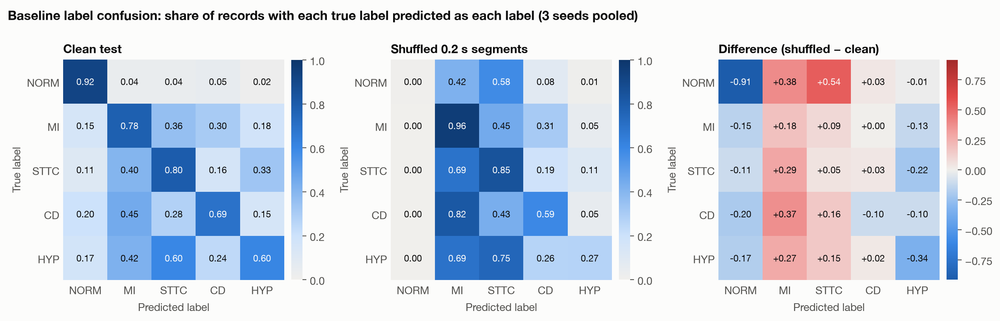
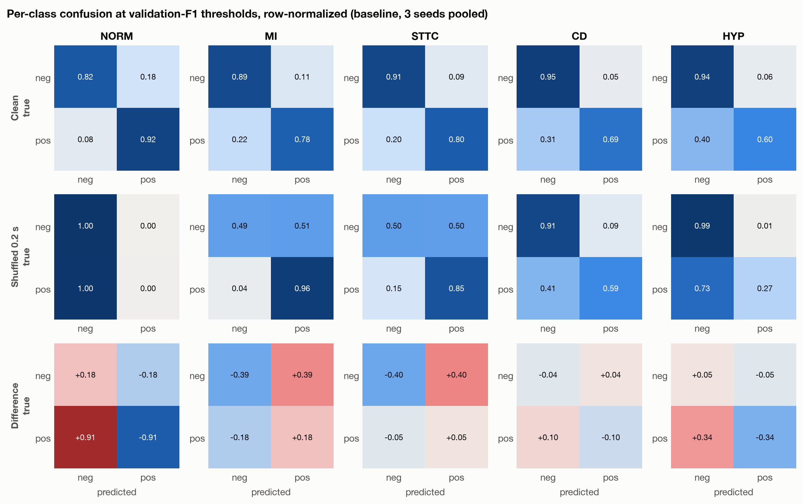

# At What Timescale Does Order Matter? A Segment-Shuffle Probe for ECG Diagnosis on PTB-XL

## Abstract

We train a 1D ResNet for multi-label classification of 12-lead ECGs into the five diagnostic
superclasses of PTB-XL (NORM, MI, STTC, CD, HYP) and reach **0.922 ± 0.001 test macro AUROC** over three
seeds. To ask whether the model relies on temporal order or on local waveform shape, we re-evaluate it on
test ECGs cut into *k* equal segments that are then randomly permuted, sweeping the segment length from
5 s to 0.2 s. Two checks make the probe interpretable: a *roll control* that introduces the same cuts while
keeping segment order, and a model *trained* on shuffled 1 s segments. Shuffling segments of 0.5 s or longer
costs no more than the roll control (macro drop 0.004 at 1 s vs 0.010 for the control), and the
shuffle-trained model matches the baseline (0.923 vs 0.922), so order above the scale of one heartbeat is
not used. Shuffling 0.2 s segments, which scrambles the P–QRS–T sequence within beats, lowers macro AUROC by
0.076, against 0.030 for the control. The effect is largest for ST/T changes (STTC: 0.153 vs 0.043).
For these five diagnoses, the relevant temporal structure lives inside a single beat.
Confusion matrices at validation-tuned thresholds add a caveat: even when AUROC barely moves, perturbed
ECGs are pushed toward "abnormal". NORM recall falls by 0.10 under 1 s shuffles, and the model almost never
predicts NORM under 0.2 s shuffles.

## 1. Introduction

A 12-lead ECG carries information at two timescales: the shape of each beat (P wave, QRS complex, ST
segment, T wave) and the rhythm across beats (RR intervals, regularity, ectopy). A convolutional network
trained end-to-end could use either. Knowing which one it uses matters for interpreting its errors, for
choosing augmentations, and for knowing which diagnoses it can be trusted on.

We measure this directly with a perturbation probe: keep local waveform content but destroy order above a
chosen timescale, and see how much performance drops. A raw drop is ambiguous, for two reasons:

1. **Cut artifacts.** Permuting segments creates discontinuities at every cut, which the model never saw in
   training. Some of the drop may come from those artifacts rather than from lost order.
2. **Use vs need.** A small drop shows the *model* does not use order. It does not show the *task* does not
   need it.

We address (1) with a control that cuts at the same boundaries but preserves order, and (2) by training a
second model on shuffled inputs.

## 2. Data

PTB-XL v1.0.3 [1] contains 21,799 clinical 10 s, 12-lead recordings from 18,869 patients, annotated with
SCP-ECG statements. We use the 100 Hz version (1,000 samples per lead), map diagnostic statements to the five
superclasses, and keep the 21,388 records with at least one diagnostic label. Records can carry several
labels.

| Superclass | Meaning | Records | Prevalence |
|---|---|---|---|
| NORM | Normal ECG | 9,514 | 44.5% |
| MI | Myocardial infarction | 5,469 | 25.6% |
| STTC | ST/T change | 5,235 | 24.5% |
| CD | Conduction disturbance | 4,898 | 22.9% |
| HYP | Hypertrophy | 2,649 | 12.4% |

We use the official stratified folds, which assign every patient to a single fold: folds 1–8 for training
(17,084 records), fold 9 for validation (2,146) and fold 10 for testing (2,158). Each lead is z-scored with
mean and standard deviation computed on the training folds only.

## 3. Methods

### 3.1 Model

A 1D ResNet [3] with 4.08 M parameters:

- **Stem:** convolution (kernel 15, stride 2, 64 channels), batch norm, ReLU, max-pool (stride 2).
- **Body:** four stages of two residual blocks each, with widths 64, 128, 256, 256 and strides 1, 2, 2, 2.
  Each block is two kernel-7 convolutions with batch norm, plus a 1×1 projection on the skip path when the
  shape changes.
- **Head:** global average and global max pooling over time, concatenated, then dropout 0.3 and a linear
  layer with five sigmoid outputs.

The receptive field of each final feature is **1,291 samples (12.9 s)**, measured from input gradients. That
is longer than the 10 s recording, so the architecture can in principle see the whole rhythm.

### 3.2 Training

Binary cross-entropy loss, AdamW [4] (learning rate 3e-3, weight decay 0.01), a one-cycle learning-rate
schedule, batch size 128, 30 epochs, and mixed precision. Augmentation applies a random amplitude scale in
[0.8, 1.2], a random circular time shift, and Gaussian noise (σ = 0.05). The checkpoint with the best
validation macro AUROC is kept; the best epoch fell between 14 and 22 across runs. The test fold is used
once per run. Every experiment is repeated with seeds 0, 1 and 2, and we report mean ± standard deviation.

### 3.3 Temporal probes

Each test ECG of length *T* is cut into *k* segments of length *T/k*, with *k* ∈ {2, 5, 10, 20, 50}
(5 s down to 0.2 s). A resting heartbeat lasts roughly 0.6–1 s, so *k* ≤ 10 keeps most beats intact and
*k* = 50 cuts through them.

- **Shuffle.** Segments are randomly permuted, independently per ECG and identically across leads. Content
  within each segment is untouched; order between segments is destroyed.
- **Roll control.** Segments stay in their original order, but each one is circularly shifted by a random
  offset within itself. This creates discontinuities at the boundaries, as the shuffle does, while keeping
  coarse order. The drop attributable to lost order is estimated as *shuffle drop − roll drop*.
- **Shuffle-trained model.** Identical to the baseline, except that every training batch is shuffled into
  10 segments (1 s) before the other augmentations. If it matches the baseline on a class, that class does
  not need order above 1 s.

The drop is the clean test AUROC minus the probed test AUROC. The random permutations and shifts are seeded,
so all models see the same perturbations.

## 4. Results

### 4.1 Classification

| Class | Baseline | Shuffle-trained |
|---|---|---|
| NORM | 0.944 ± 0.001 | 0.943 ± 0.002 |
| MI | 0.922 ± 0.003 | 0.923 ± 0.004 |
| STTC | 0.932 ± 0.002 | 0.932 ± 0.001 |
| CD | 0.916 ± 0.003 | 0.920 ± 0.001 |
| HYP | 0.896 ± 0.003 | 0.894 ± 0.003 |
| **Macro** | **0.922 ± 0.001** | **0.923 ± 0.001** |

*Table 1. Test AUROC, mean ± std over 3 seeds.*



*Figure 1. Training loss and validation macro AUROC per epoch (line: mean of 3 seeds; band: min to max).
Validation AUROC plateaus around epoch 15–20 and the baseline then declines slightly as training loss keeps
falling, which is why the best-validation checkpoint is used. The shuffle-trained model fits the training
set less tightly and declines less.*

The baseline falls in the range reported for 1D CNNs on this task in the PTB-XL benchmark [2]
(about 0.92–0.93 macro AUROC). HYP is the hardest class, consistent with it being the rarest. Validation
macro AUROC was 0.924–0.926 for the baseline, close to test, so there is no sign of overfitting to
the validation fold.

### 4.2 Segment sweep

| Segments (length) | 2 (5 s) | 5 (2 s) | 10 (1 s) | 20 (0.5 s) | 50 (0.2 s) |
|---|---|---|---|---|---|
| Shuffle | 0.001 ± 0.000 | 0.001 ± 0.001 | 0.004 ± 0.001 | 0.019 ± 0.005 | **0.076 ± 0.011** |
| Roll control | 0.001 ± 0.001 | 0.002 ± 0.001 | 0.010 ± 0.003 | 0.032 ± 0.007 | 0.030 ± 0.006 |
| Shuffle − roll | −0.001 | −0.000 | −0.006 | −0.014 | **+0.047** |

*Table 2. Macro AUROC drop for the baseline model, mean ± std over 3 seeds.*



*Figure 2. Macro AUROC drop against segment length (line: mean of 3 seeds; band: ± std). The two curves cross
between 0.5 s and 0.2 s. Above that scale the shuffle costs no more than the roll control; below it,
shuffling costs much more.*

Two regimes appear:

- **Segments of 0.5 s or longer.** Both drops are small, and the shuffle is never worse than the control:
  *shuffle − roll* is zero or negative. Destroying order adds nothing beyond the cuts themselves.
- **0.2 s segments.** The shuffle drop rises sharply to 0.076 while the control stays at 0.030, leaving a
  gap of 0.047. Segments this short separate the P wave, QRS complex and T wave, so shuffling them scrambles
  the sequence inside each beat. The control keeps that sequence, apart from small shifts.

### 4.3 Per-class effects

| Class | Shuffle, 1 s | Roll, 1 s | Shuffle, 0.2 s | Roll, 0.2 s | Shuffle − roll, 0.2 s |
|---|---|---|---|---|---|
| NORM | 0.006 | 0.011 | 0.080 | 0.024 | 0.056 |
| MI | 0.002 | 0.006 | 0.036 | 0.021 | 0.016 |
| STTC | 0.006 | 0.014 | **0.153** | 0.043 | **0.110** |
| CD | 0.003 | 0.010 | 0.056 | 0.039 | 0.016 |
| HYP | 0.002 | 0.007 | 0.055 | 0.020 | 0.035 |
| **Macro** | **0.004** | **0.010** | **0.076** | **0.030** | **0.047** |

*Table 3. AUROC drop by class for the baseline model, mean over 3 seeds.*



*Figure 3. Baseline AUROC drop for every class and segment length. Left and middle share one sequential scale.
The right panel is the difference on a diverging scale: red means shuffling hurts more than the control,
which is the effect of order; blue means less. Red appears only in the 0.2 s column, and it is darkest for
STTC.*

At 1 s every class drops by less than 0.01. At 0.2 s, within-beat order matters most for **STTC** (0.110 beyond
the control) and **NORM** (0.056). It matters least for **MI** and **CD** (about 0.02 each).

### 4.4 Shuffle-trained model

| Segments (length) | 2 (5 s) | 5 (2 s) | 10 (1 s) | 20 (0.5 s) | 50 (0.2 s) |
|---|---|---|---|---|---|
| Shuffle | −0.000 | −0.000 | 0.000 | 0.006 | 0.049 |
| Roll control | −0.001 | −0.001 | 0.002 | 0.021 | 0.025 |

*Table 4. Macro AUROC drop for the shuffle-trained model, mean over 3 seeds.*

Training on shuffled 1 s segments costs nothing on clean test data (Table 1). The model becomes insensitive
to shuffles at 1 s and above and less sensitive at 0.5 s (0.006 vs 0.019 for the baseline). It is still
hurt by 0.2 s shuffles (0.049), which it never saw in training, and within-beat order still exceeds the control
there (+0.024).

### 4.5 Confusion matrices

AUROC measures ranking. To see how *decisions* change, we fix one threshold per class and seed, chosen to
maximize F1 on the validation fold. We then apply it to clean and perturbed test ECGs and pool the 3 seeds.



*Figure 4. Multi-label confusion for the baseline. Row *i* contains the test records whose true labels include
class *i*; column *j* shows the share of them predicted as class *j*. Rows do not sum to 1, because
records can carry several labels. Off-diagonal cells therefore mix two things: real co-occurrence (for
example, MI and STTC often appear together) and errors. Right: shuffled minus clean.*



*Figure 5. Per-class 2×2 confusion matrices, normalized by row (the true class). Top: clean test. Middle:
0.2 s shuffle. Bottom: difference.*

On clean data, the per-class recall (true-positive rate) is 0.92 for NORM, 0.80 for STTC, 0.78 for MI, 0.69 for CD and 0.60 for HYP. Specificity is
0.82–0.95. HYP and CD are missed most often, which matches their lower AUROC. The largest off-diagonal
entries in the clean matrix are HYP→STTC (0.60) and CD→MI (0.45). These reflect clinical co-occurrence as well
as confusion: hypertrophy often comes with repolarization (ST/T) changes.

Under the 0.2 s shuffle, the decisions collapse in one direction. **The model stops predicting NORM**: it
predicts NORM for 0.2% of records, against 51% on clean data. It predicts MI and STTC far more often. Their
false-positive rates rise from 0.11 to 0.51 and from 0.09 to 0.50. Scrambled beats look *abnormal* rather than like any
specific diagnosis. The NORM AUROC is still 0.86 at this scale, so the ranking is partly preserved; it is
the score *level* that shifts.

The same thing happens on a smaller scale at 1 s. AUROC changes by less than 0.01, yet at fixed thresholds
NORM recall falls by 0.10 under the shuffle and by 0.22 under the roll control. Perturbations that barely
change the ranking still shift the calibration, and cut artifacts by themselves push scores toward
"abnormal".

## 5. Limitations

- **Imperfect control.** The roll control adds a discontinuity *inside* each segment (at the wrap point) as
  well as at the boundaries, and it shifts waveform positions by up to one segment length. It therefore
  likely overstates the cost of the cuts, which is why *shuffle − roll* is slightly negative at 1–0.5 s. The
  main conclusion does not rely on the control: the absolute drop at 1 s is only 0.004.
- **Label scope.** Only the five diagnostic superclasses are tested. Rhythm labels (e.g. atrial fibrillation,
  sinus arrhythmia) should show large coarse-scale drops and would be the natural positive control.
- **Statistical precision.** Three seeds give tight seed-to-seed spread (std ≤ 0.005 on test AUROC), but test-set
  sampling uncertainty is not captured. Bootstrap confidence intervals over the 2,158 test records would be the
  next step.
- **One architecture, one sampling rate.** Results are for a single 1D ResNet at 100 Hz. Higher sampling rates
  preserve more morphology and might shift the within-beat effects.

## 6. Reproducing the results

```bash
pip install -e ".[dev]"
python scripts/download_data.py --rate 100              # PhysioNet AWS mirror, ~0.5 GB
pytest
python scripts/train.py --config configs/default.yaml --seed 0
python scripts/train.py --config configs/shuffle_trained.yaml --seed 0
python scripts/aggregate.py runs/resnet1d_baseline      # prints Tables 1-3, writes summary.json
python scripts/predict.py runs/resnet1d_baseline        # per-record probabilities for the confusion matrices
python scripts/plot_results.py --out figures            # Figures 1-5
```

Override any config value from the command line, e.g. `--set train.epochs=10 model.dropout=0.5`.

On a SLURM cluster:

```bash
sbatch scripts/slurm_setup.sh                                 # once: env, data, signal cache, tests
sbatch scripts/slurm_train.sh                                 # baseline, 3 seeds + aggregate
sbatch scripts/slurm_train.sh configs/shuffle_trained.yaml    # shuffle-trained, 3 seeds + aggregate
sbatch scripts/slurm_predict.sh                               # saved predictions for both models
```

**Compute.** One NVIDIA V100 (SXM2) per job: about 2 s per epoch, about 5 minutes for 3 seeds including all
probes.

**Code layout.**

```
configs/default.yaml           baseline hyperparameters, probe segment counts
configs/shuffle_trained.yaml   same, trained on 10-segment shuffles
src/ecg/data.py                loading, label aggregation, folds, normalization, signal cache
src/ecg/model.py               1D ResNet
src/ecg/transforms.py          augmentation, shuffle probe, roll control
src/ecg/engine.py              train, predict and evaluate loops
src/ecg/metrics.py             AUROC and score lookup
scripts/train.py               train, select on validation, test, run probes
scripts/aggregate.py           mean and std across seeds, summary.json
scripts/predict.py             per-record probabilities, clean and probed, for each checkpoint
scripts/plot_results.py        report figures
figures/                       Figures 1-5
logs/                          SLURM logs from the reported runs (see logs/README.md)
runs/                          per-seed results.json, history.json, config.yaml and summary.json
scripts/download_data.py       parallel download from the PhysioNet AWS mirror
scripts/slurm_setup.sh         one-time SLURM setup
scripts/slurm_train.sh         3-seed SLURM job (takes a config path)
scripts/slurm_predict.sh       SLURM job for predict.py on both models
tests/                         shape, probe and scoring sanity checks
```

## References

[1] P. Wagner, N. Strodthoff, R.-D. Bousseljot, D. Kreiseler, F. I. Lunze, W. Samek, T. Schaeffter.
PTB-XL, a large publicly available electrocardiography dataset. *Scientific Data*, 7, 154, 2020.

[2] N. Strodthoff, P. Wagner, T. Schaeffter, W. Samek. Deep learning for ECG analysis: benchmarks and
insights from PTB-XL. *IEEE Journal of Biomedical and Health Informatics*, 25(5), 1519–1528, 2021.

[3] K. He, X. Zhang, S. Ren, J. Sun. Deep residual learning for image recognition. *CVPR*, 2016.

[4] I. Loshchilov, F. Hutter. Decoupled weight decay regularization. *ICLR*, 2019.
