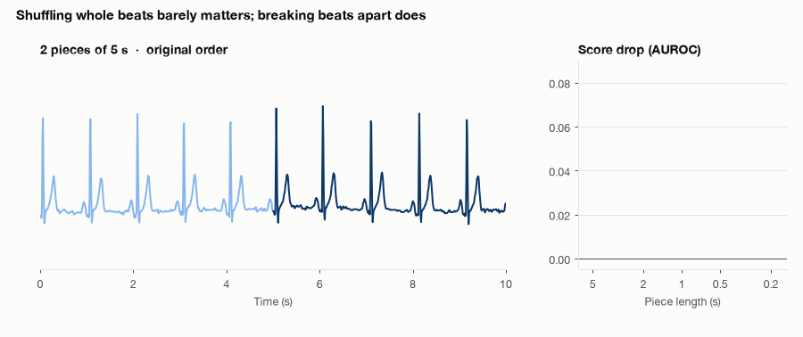
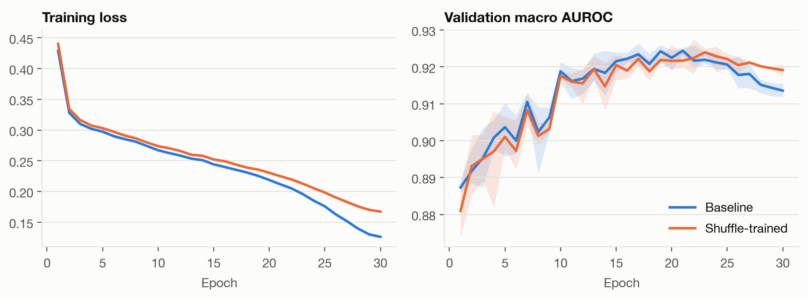
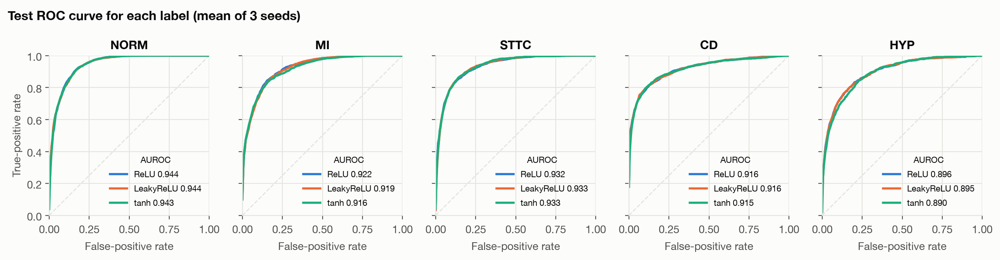
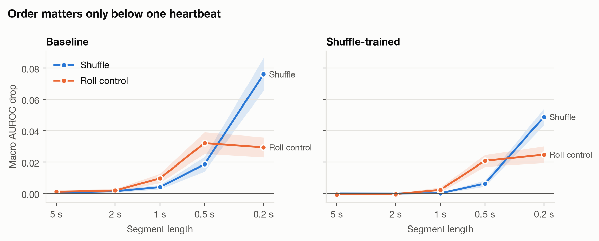
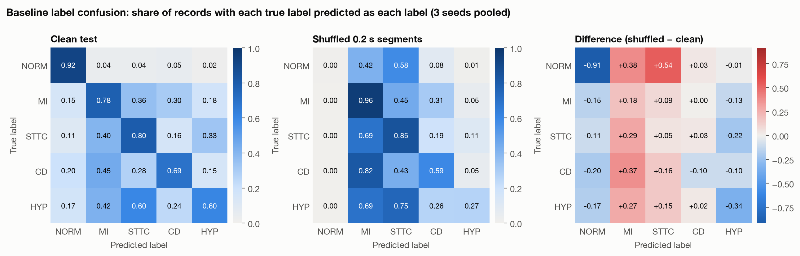
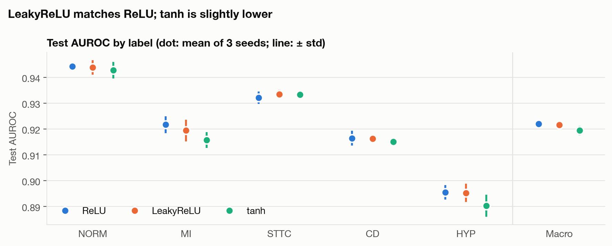
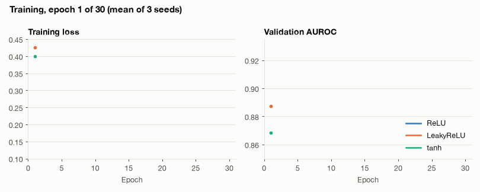
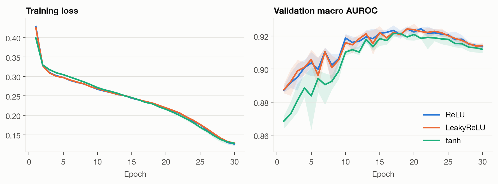
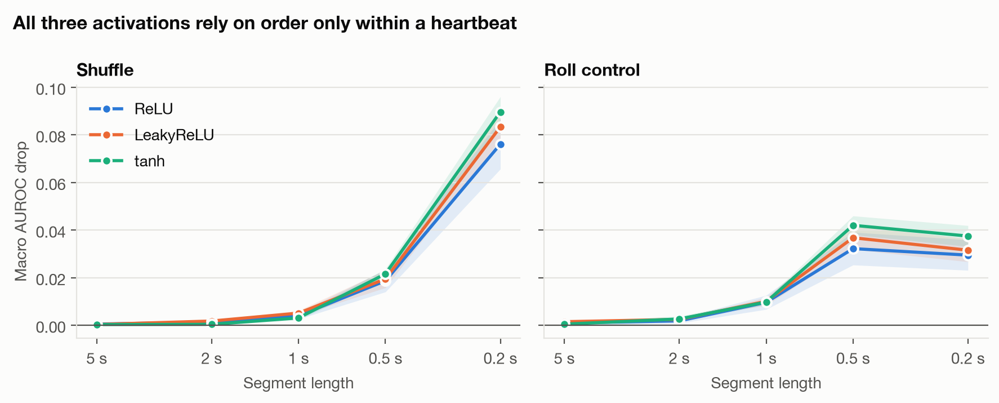

# Does the Order of Heartbeats Matter? Testing an ECG Model by Shuffling Its Input



*A real test ECG (lead II) cut into 5, 2, 1, 0.5 and 0.2-second pieces and shuffled. Right: how much the
model's score drops at each piece length, over the whole test set. Shuffling whole beats barely matters;
breaking beats apart does.*

**Jump to:** [Summary](#summary) · [Results](#4-results) · [Activation comparison](#5-comparing-activation-functions-relu-leakyrelu-and-tanh) · [**Reproduce it**](#7-how-to-reproduce) · [Check the numbers in 1 minute](#71-check-the-reported-numbers-1-minute-no-data-or-gpu) · [Code layout](#75-where-things-are) · [Short report (PDF)](report/activation_report.pdf)

## Summary

We trained a neural network to read 12-lead ECGs from the PTB-XL dataset and flag five kinds of diagnosis:
normal, heart attack, ST/T changes, conduction problems and enlarged heart muscle. It scores
**0.922 out of 1** on our main measure (AUROC, explained below), averaged over three training runs.

We then asked a simple question: **does the model care about the order of things in the ECG, or only about
the shape of each small piece?** To find out, we cut each test ECG into equal pieces, shuffled the pieces,
and checked how much the score dropped.

What we found:

- **Shuffling whole heartbeats barely matters.** Cutting the ECG into 1-second pieces (about one beat each)
  and shuffling them lowers the score by only 0.004. A second model trained on shuffled ECGs from the start
  scores just as well as the normal one (0.923 vs 0.922). So for these five diagnoses, the model does not use
  the rhythm across beats.
- **Shuffling within a heartbeat does matter.** Cutting into 0.2-second pieces breaks each beat apart, and the
  score drops by 0.076. ST/T changes are hit hardest (0.153).
- **Shuffled ECGs look "abnormal" to the model.** Even when the score barely changes, shuffled ECGs get
  pushed away from "normal". With 0.2-second pieces the model almost never says "normal" at all.
- **Changing the activation function makes little difference.** Swapping ReLU for LeakyReLU gives the same
  score (0.922), and tanh is slightly lower (0.919). All three versions react to shuffling the same way
  (Section 5).

## 1. Background

An ECG records the heart's electrical activity. Each heartbeat makes a familiar shape: a small bump (the
**P wave**), a sharp spike (the **QRS complex**), a flat stretch (the **ST segment**) and another bump (the
**T wave**). A 10-second ECG holds about 10 of these beats.

So an ECG carries two kinds of information:

1. **Shape**: what each beat looks like.
2. **Rhythm**: how the beats are spaced and whether they are regular.

A neural network trained on raw ECGs could learn from either one. Knowing which one it relies on helps us
understand its mistakes and know which diagnoses we can trust it on.

Our test keeps the shape of each small piece but scrambles their order. If the score stays the same, the
model was not using the order. There are two catches:

1. **The cuts themselves.** Shuffling creates sudden jumps where pieces meet, which the model never saw
   during training. Part of any score drop could come from these jumps rather than from losing the order.
   We check this with a **control** that makes the same cuts but keeps the pieces in order.
2. **"Doesn't use" is not "doesn't need".** A model ignoring order doesn't prove the diagnosis doesn't need
   it. We check this by training a second model on shuffled ECGs and seeing whether it does worse.

## 2. Data

**PTB-XL** [1] is a public dataset of 21,799 ECGs from 18,869 patients. Each is 10 seconds long with 12 leads
(12 views of the heart from different electrode positions). We use the version recorded at 100 samples per
second, so each lead is 1,000 numbers long. We keep the 21,388 ECGs that have at least one diagnosis label.
One ECG can have several labels.

| Label | Meaning | ECGs | Share |
|---|---|---|---|
| NORM | Normal ECG | 9,514 | 44.5% |
| MI | Myocardial infarction (heart attack) | 5,469 | 25.6% |
| STTC | ST/T change (unusual ST segment or T wave) | 5,235 | 24.5% |
| CD | Conduction disturbance (electrical signal travels abnormally) | 4,898 | 22.9% |
| HYP | Hypertrophy (thickened heart muscle) | 2,649 | 12.4% |

PTB-XL comes split into 10 groups, with each patient in only one group. We use groups 1–8 for training
(17,084 ECGs), group 9 for choosing the best model during training (2,146) and group 10 for the final test
(2,158). Each lead is rescaled to an average of 0 and a spread of 1, using numbers from the training groups
only.

## 3. Method

### 3.1 Model

We use a **1D ResNet** [3], a common type of convolutional neural network, with 4.08 million learned
parameters. It works in three parts:

- **Start:** one wide filter (15 samples) scans the 12 leads and turns them into 64 feature channels, then
  halves the length twice.
- **Middle:** eight "residual blocks". Each block runs two filters over the signal and adds the result back
  to its input. This shortcut makes deep networks easier to train. The number of channels grows from 64 to
  256 and the length keeps shrinking.
- **End:** the model takes the average and the maximum of each channel over time, then a final layer gives
  one probability per label.

After every filter the model applies an **activation function**, which is what lets the network learn
non-linear patterns. The main model uses **ReLU**, which keeps positive values and sets negative ones to
zero. Section 5 compares it with two alternatives:

- **LeakyReLU** keeps a small part (1%) of negative values instead of zeroing them, so no part of the
  network ever goes completely silent.
- **tanh** squashes every value into the range −1 to 1 along a smooth S-shaped curve. It was common in older
  networks and treats positive and negative values alike.

Each output of the middle part can "see" 12.9 seconds of input, longer than the whole 10-second ECG. So the
model is able to take in the full rhythm if it wants to.

### 3.2 Training

- **Loss:** binary cross-entropy, one yes/no decision per label.
- **Optimizer:** AdamW [4], learning rate 0.003, weight decay 0.01. The learning rate rises then falls over
  training (a "one-cycle" schedule).
- **Length:** 30 passes over the training data, 128 ECGs per batch.
- **Augmentation:** to make the model more robust, each training ECG is randomly made up to 20% louder or quieter,
  shifted in time, and given a little random noise.
- **Picking the model:** after each pass we score the model on group 9 and keep the best version. The best
  pass was between 14 and 22.
- **Repeats:** every experiment is run three times with different random seeds (0, 1, 2). We report the
  average ± the spread (standard deviation).

**How we score.** We use **AUROC** for each label. It asks: if you pick one ECG that has the label and one
that doesn't, how often does the model give the first a higher score? 1.0 is perfect and 0.5 is a coin
flip. The **macro** score is the average over the five labels. A **drop** is the normal test score minus
the score after shuffling.

### 3.3 The shuffle test

Each test ECG is cut into *k* equal pieces, with *k* = 2, 5, 10, 20 or 50. That is pieces of 5, 2, 1, 0.5 or
0.2 seconds. A resting heartbeat lasts about 0.6–1 second, so pieces of 1 second or more mostly keep beats
whole, and 0.2-second pieces cut through them.

- **Shuffle:** the pieces are put in a random order. All 12 leads are shuffled the same way.
- **Control:** the pieces stay in order, but each one is rotated by a random amount inside itself. This
  creates jumps at the cuts like the shuffle does, while keeping the overall order. The difference
  *shuffle drop − control drop* tells us how much the order itself mattered.
- **Shuffle-trained model:** same as the main model, but every training ECG is cut into 1-second pieces and
  shuffled. If it matches the main model on a label, that label doesn't need order above 1 second.

The random shuffles are fixed by a seed, so every model is tested on exactly the same shuffled ECGs.

## 4. Results

### 4.1 How well the models classify

| Label | Main model | Shuffle-trained |
|---|---|---|
| NORM | 0.944 ± 0.001 | 0.943 ± 0.002 |
| MI | 0.922 ± 0.003 | 0.923 ± 0.004 |
| STTC | 0.932 ± 0.002 | 0.932 ± 0.001 |
| CD | 0.916 ± 0.003 | 0.920 ± 0.001 |
| HYP | 0.896 ± 0.003 | 0.894 ± 0.003 |
| **Macro** | **0.922 ± 0.001** | **0.923 ± 0.001** |

*Table 1. Test AUROC, average ± spread over 3 runs.*



*Figure 1. Training loss and validation score after each pass (line: average of 3 runs; band: lowest to
highest). The score levels off around pass 15–20, after which the main model gets slightly worse while its
training loss keeps falling. That is why we keep the best version rather than the last one.*



*Figure 2. ROC curve for each label on the test set. Each curve shows, for every possible cut-off, how many
real cases the model catches (up) against how many false alarms it raises (right). A curve hugging the top-left
corner is better; the dashed diagonal is guessing. AUROC is the area under the curve. The three activation
functions are shown together; their curves nearly overlap (see Section 5).*

The main model scores in the same range as similar models in the published PTB-XL benchmark [2] (about
0.92–0.93). HYP is the hardest label, which fits with it being the rarest. Validation scores (0.924–0.926)
are close to test scores, so the model did not overfit to the validation group.

### 4.2 Shuffling at different piece sizes

| Pieces (length) | 2 (5 s) | 5 (2 s) | 10 (1 s) | 20 (0.5 s) | 50 (0.2 s) |
|---|---|---|---|---|---|
| Shuffle | 0.001 ± 0.000 | 0.001 ± 0.001 | 0.004 ± 0.001 | 0.019 ± 0.005 | **0.076 ± 0.011** |
| Control | 0.001 ± 0.001 | 0.002 ± 0.001 | 0.010 ± 0.003 | 0.032 ± 0.007 | 0.030 ± 0.006 |
| Shuffle − control | −0.001 | −0.000 | −0.006 | −0.014 | **+0.047** |

*Table 2. Drop in macro AUROC for the main model, average ± spread over 3 runs.*



*Figure 3. Score drop for each piece length (line: average of 3 runs; band: ± spread). The two lines cross
between 0.5 and 0.2 seconds.*

- **Pieces of 0.5 seconds or longer:** both drops are small, and shuffling never hurts more than the
  control. Losing the order adds nothing beyond the effect of the cuts.
- **0.2-second pieces:** the shuffle drop jumps to 0.076 while the control stays at 0.030. Pieces this short
  separate the P wave, QRS complex and T wave, so shuffling scrambles the inside of each beat. The control
  keeps each beat in order.

### 4.3 Which labels are affected

| Label | Shuffle, 1 s | Control, 1 s | Shuffle, 0.2 s | Control, 0.2 s | Shuffle − control, 0.2 s |
|---|---|---|---|---|---|
| NORM | 0.006 | 0.011 | 0.080 | 0.024 | 0.056 |
| MI | 0.002 | 0.006 | 0.036 | 0.021 | 0.016 |
| STTC | 0.006 | 0.014 | **0.153** | 0.043 | **0.110** |
| CD | 0.003 | 0.010 | 0.056 | 0.039 | 0.016 |
| HYP | 0.002 | 0.007 | 0.055 | 0.020 | 0.035 |
| **Macro** | **0.004** | **0.010** | **0.076** | **0.030** | **0.047** |

*Table 3. Drop in AUROC per label for the main model, average over 3 runs.*

With 1-second pieces, every label drops by less than 0.01. With 0.2-second pieces, the order inside a beat
matters most for **STTC** (0.110 more than the control) and **NORM** (0.056), and least for **MI** and **CD**
(about 0.02 each). This makes sense: spotting an ST/T change means knowing what comes right after the QRS
spike.

### 4.4 The shuffle-trained model

| Pieces (length) | 2 (5 s) | 5 (2 s) | 10 (1 s) | 20 (0.5 s) | 50 (0.2 s) |
|---|---|---|---|---|---|
| Shuffle | −0.000 | −0.000 | 0.000 | 0.006 | 0.049 |
| Control | −0.001 | −0.001 | 0.002 | 0.021 | 0.025 |

*Table 4. Drop in macro AUROC for the shuffle-trained model, average over 3 runs.*

Training on shuffled 1-second pieces costs nothing on normal ECGs (Table 1). This model isn't bothered by
shuffles of 1 second or more, and is less bothered by 0.5-second ones (0.006 vs 0.019 for the main model). It
still loses 0.049 with 0.2-second pieces, which it never saw in training.

### 4.5 What the model actually decides

AUROC only measures whether the model *ranks* ECGs correctly. To see its actual yes/no decisions, we set one
cut-off per label (chosen on the validation group to balance missed and false alarms) and count how often it
is right on normal and shuffled test ECGs, combining all 3 runs.



*Figure 4. Which labels the main model predicts. Row = the true label, column = the predicted label, value =
share of that row's ECGs given that prediction. Rows don't add up to 1 because one ECG can have several
labels, so some off-diagonal values are real overlaps (heart attacks often come with ST/T changes) rather
than mistakes. Right: shuffled minus normal.*

**On normal ECGs**, the model catches 92% of NORM cases, 80% of STTC, 78% of MI, 69% of CD and 60% of HYP. It
correctly says "no" to 82–95% of ECGs without each label. HYP and CD are missed most, matching their lower
scores. The biggest overlaps are HYP→STTC (60%) and CD→MI (45%), which partly reflects real medicine:
thickened heart muscle often comes with ST/T changes.

**With 0.2-second shuffling, the model stops saying "normal".** It labels 0.2% of ECGs as NORM, against 51%
on normal data, and says MI and STTC far more often (false alarms rise from 11% to 51% and from 9% to 50%).
Scrambled beats just look "abnormal" to the model rather than like one specific diagnosis.

**The same thing happens on a smaller scale with 1-second pieces.** The score barely moves, but the model
catches 10% fewer NORM cases after shuffling and 22% fewer after the control. Even the cuts alone push the
model toward "abnormal".

## 5. Comparing activation functions: ReLU, LeakyReLU and tanh

We trained two more versions of the main model, identical except for the activation function, with the same
settings, the same 3 seeds and the same shuffle tests.

### 5.1 Accuracy

| Label | ReLU (main) | LeakyReLU | tanh |
|---|---|---|---|
| NORM | 0.944 ± 0.001 | 0.944 ± 0.003 | 0.943 ± 0.003 |
| MI | 0.922 ± 0.003 | 0.919 ± 0.004 | 0.916 ± 0.003 |
| STTC | 0.932 ± 0.002 | 0.934 ± 0.002 | 0.933 ± 0.000 |
| CD | 0.916 ± 0.003 | 0.916 ± 0.001 | 0.915 ± 0.001 |
| HYP | 0.896 ± 0.003 | 0.895 ± 0.004 | 0.890 ± 0.004 |
| **Macro** | **0.922 ± 0.001** | **0.922 ± 0.002** | **0.919 ± 0.002** |

*Table 5. Test AUROC for each activation function, average ± spread over 3 runs.*



*Figure 5. Test AUROC for each label and activation function (dot: average of 3 runs; line: ± spread).*





*Figure 6. Training loss and validation score after each pass, for each activation function (line: average
of 3 runs; band: lowest to highest). tanh starts noticeably slower in the first 10 passes, then catches up
most of the way.*

- **LeakyReLU matches ReLU.** The macro score is the same, and no label differs by more than 0.003, which is
  about the size of the run-to-run spread.
- **tanh is slightly worse.** It is 0.003 lower overall, mostly on MI (−0.006) and HYP (−0.006). That is a
  small but consistent gap: every tanh run scored below every ReLU run on validation (0.922–0.924 vs
  0.924–0.926).
- **Training looks similar for all three.** tanh starts slower, but the best version came at pass 14–20 in
  every run, and all three start to overfit after that in the same way.

One likely reason ReLU's known weakness doesn't show up here: ReLU can leave parts of a network permanently
stuck at zero, which LeakyReLU is meant to fix. But this model rescales values (batch normalization) before
every activation, which keeps that from happening much in the first place.

### 5.2 Shuffle test

| Pieces (length) | 2 (5 s) | 5 (2 s) | 10 (1 s) | 20 (0.5 s) | 50 (0.2 s) |
|---|---|---|---|---|---|
| ReLU: shuffle | 0.001 | 0.001 | 0.004 | 0.019 | 0.076 ± 0.011 |
| LeakyReLU: shuffle | 0.000 | 0.002 | 0.005 | 0.020 | 0.083 ± 0.005 |
| tanh: shuffle | 0.000 | 0.000 | 0.003 | 0.022 | 0.090 ± 0.006 |
| ReLU: control | 0.001 | 0.002 | 0.010 | 0.032 | 0.030 |
| LeakyReLU: control | 0.002 | 0.003 | 0.010 | 0.037 | 0.032 |
| tanh: control | 0.001 | 0.003 | 0.010 | 0.042 | 0.038 |

*Table 6. Drop in macro AUROC for each activation function, average over 3 runs.*

| | ReLU | LeakyReLU | tanh |
|---|---|---|---|
| Macro, shuffle − control at 0.2 s | 0.047 | 0.052 | 0.052 |
| STTC, shuffle drop at 0.2 s | 0.153 | 0.179 | 0.179 |
| STTC, shuffle − control at 0.2 s | 0.110 | 0.136 | 0.118 |

*Table 7. How much order inside a heartbeat matters, for each activation function.*



*Figure 7. Drop in macro AUROC for each piece length and activation function. The three lines nearly
overlap.*

**The main finding holds for all three.** Shuffling whole beats (1 second or longer) costs almost nothing,
and shuffling within a beat (0.2 seconds) costs a lot, with STTC hit hardest. The activation function does
not change *what* the model relies on.

LeakyReLU and tanh are a little *more* sensitive to 0.2-second shuffles than ReLU (0.083 and 0.090 vs 0.076),
and the order inside a beat matters slightly more to them (0.052 vs 0.047). These gaps are about one spread
apart, so they hint that the other two lean a bit harder on beat shape, but they are too small to be sure
with three runs.

**Bottom line:** for this task, ReLU is a fine default. LeakyReLU is an equal swap with no benefit, and tanh
costs a little accuracy.

All the numbers behind this section are in `figures/activation_metrics.csv`. A short stand-alone write-up is
in [`report/activation_report.md`](report/activation_report.md) ([PDF](report/activation_report.pdf)).

## 6. Limitations

- **The control isn't perfect.** Rotating a piece adds an extra jump inside it and moves the waveform around,
  so the control probably overstates the cost of the cuts. That is why *shuffle − control* is slightly
  negative at 1 and 0.5 seconds. The main conclusion doesn't depend on it, though: the plain shuffle drop at
  1 second is only 0.004.
- **Only five labels.** We didn't test rhythm diagnoses like atrial fibrillation, where shuffling whole beats
  should matter a lot. Those would be the natural next check.
- **Only three runs.** The runs agree closely (spread ≤ 0.005), but this doesn't measure how much the score
  would change with a different test set. Bootstrap resampling of the test ECGs would cover that.
- **One model design, one sampling rate.** Results are for one 1D ResNet at 100 samples per second (with
  three activation functions). Higher
  rates keep more detail in each beat and could change the within-beat results.

## 7. How to reproduce

Three levels, from quickest to complete:

| | What you get | Needs | Time |
|---|---|---|---|
| [7.1](#71-check-the-reported-numbers-1-minute-no-data-or-gpu) | Every table in this README, from the saved results | Python only | ~1 minute |
| [7.2](#72-full-run-on-one-machine) | Everything retrained from scratch | PTB-XL download, a GPU recommended | ~30 minutes on one GPU |
| [7.3](#73-on-a-slurm-cluster) | Same, as cluster jobs | A SLURM cluster | ~5 minutes per model |

### 7.1 Check the reported numbers (1 minute, no data or GPU)

The per-seed results of every run are committed in `runs/`, so the tables can be recomputed without
downloading data or training anything:

```bash
git clone https://github.com/dhairyab0069/ecg-diagnostic-classification-ptbxl.git
cd ecg-diagnostic-classification-ptbxl
pip install numpy scikit-learn                     # all this step needs; no PyTorch
export PYTHONPATH=src
python scripts/aggregate.py runs/resnet1d_baseline          # Tables 1-3 (main model)
python scripts/aggregate.py runs/resnet1d_shuffle_trained   # Tables 1 and 4
python scripts/aggregate.py runs/resnet1d_leaky_relu        # Tables 5-7, LeakyReLU column
python scripts/aggregate.py runs/resnet1d_tanh              # Tables 5-7, tanh column
```

`figures/activation_metrics.csv` has the activation comparison in one table, and `logs/` has the original
cluster output for every run (see [logs/README.md](logs/README.md)).

### 7.2 Full run on one machine

```bash
pip install -e ".[dev]"
python scripts/download_data.py --rate 100              # downloads PTB-XL, about 0.5 GB
pytest                                                  # quick sanity checks
for seed in 0 1 2; do                                   # 3 runs per model, as reported
  python scripts/train.py --config configs/default.yaml --seed $seed           # main model (ReLU)
  python scripts/train.py --config configs/shuffle_trained.yaml --seed $seed   # shuffle-trained model
  python scripts/train.py --config configs/leaky_relu.yaml --seed $seed        # LeakyReLU model
  python scripts/train.py --config configs/tanh.yaml --seed $seed              # tanh model
done
python scripts/aggregate.py runs/resnet1d_baseline      # prints Tables 1-3, writes summary.json
python scripts/predict.py runs/resnet1d_baseline        # saves predictions for Figures 2 and 4 (repeat per model)
python scripts/plot_results.py --out figures            # makes Figures 1-7 and activation_metrics.csv
python scripts/make_gifs.py --out figures               # makes the two animations
```

You can change any setting from the command line, e.g. `--set train.epochs=10 model.dropout=0.5`. To try a
different LeakyReLU slope, change `model.negative_slope` in `configs/leaky_relu.yaml`.

### 7.3 On a SLURM cluster

We used Northeastern's Explorer cluster:

```bash
sbatch scripts/slurm_setup.sh                                 # once: environment, data, tests
sbatch scripts/slurm_train.sh                                 # main model, 3 runs + summary
sbatch scripts/slurm_train.sh configs/shuffle_trained.yaml    # shuffle-trained model
sbatch scripts/slurm_train.sh configs/leaky_relu.yaml         # LeakyReLU model
sbatch scripts/slurm_train.sh configs/tanh.yaml               # tanh model
sbatch scripts/slurm_predict.sh                               # saved predictions (baseline, shuffle-trained)
sbatch scripts/slurm_predict.sh runs/resnet1d_leaky_relu runs/resnet1d_tanh   # same for the new models
```

### 7.4 Hardware

One NVIDIA V100 GPU per job: about 2 seconds per pass, about 5 minutes for all 3 runs including
the shuffle tests.

### 7.5 Where things are

```
configs/default.yaml           main model settings
configs/shuffle_trained.yaml   same, trained on shuffled 1 s pieces
configs/leaky_relu.yaml        same as main, with LeakyReLU instead of ReLU
configs/tanh.yaml              same as main, with tanh instead of ReLU
src/ecg/data.py                loading data, labels, train/val/test split, rescaling
src/ecg/model.py               the 1D ResNet (activation is set in the config)
src/ecg/transforms.py          augmentation, shuffle test, control
src/ecg/engine.py              training and evaluation loops
src/ecg/metrics.py             AUROC
scripts/train.py               train, pick best version, test, run shuffle tests
scripts/aggregate.py           average and spread across runs, summary.json
scripts/predict.py             saves per-ECG predictions
scripts/plot_results.py        makes the figures
scripts/make_gifs.py           makes the animations (anim_shuffle.gif, anim_training.gif)
scripts/download_data.py       downloads PTB-XL
scripts/slurm_*.sh             cluster job scripts
figures/                       Figures 1-7, animations, extra_*.png supporting figures, activation_metrics.csv
report/                        short activation-function report (Markdown and PDF)
logs/                          cluster logs from the reported runs (see logs/README.md)
runs/                          results for every run, plus summary.json per model
tests/                         sanity checks
```

## References

[1] P. Wagner, N. Strodthoff, R.-D. Bousseljot, D. Kreiseler, F. I. Lunze, W. Samek, T. Schaeffter.
PTB-XL, a large publicly available electrocardiography dataset. *Scientific Data*, 7, 154, 2020.

[2] N. Strodthoff, P. Wagner, T. Schaeffter, W. Samek. Deep learning for ECG analysis: benchmarks and
insights from PTB-XL. *IEEE Journal of Biomedical and Health Informatics*, 25(5), 1519–1528, 2021.

[3] K. He, X. Zhang, S. Ren, J. Sun. Deep residual learning for image recognition. *CVPR*, 2016.

[4] I. Loshchilov, F. Hutter. Decoupled weight decay regularization. *ICLR*, 2019.
