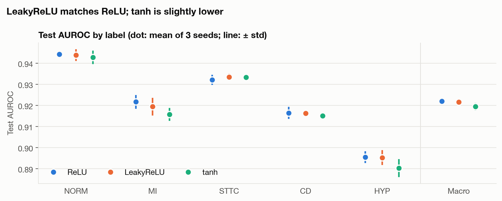
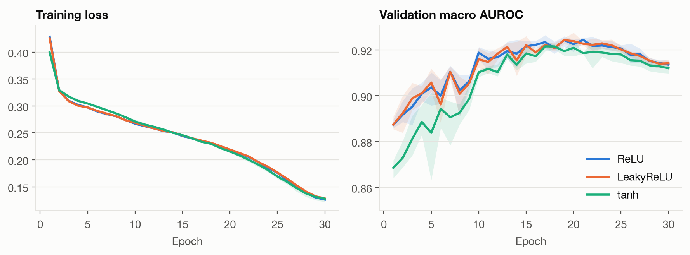
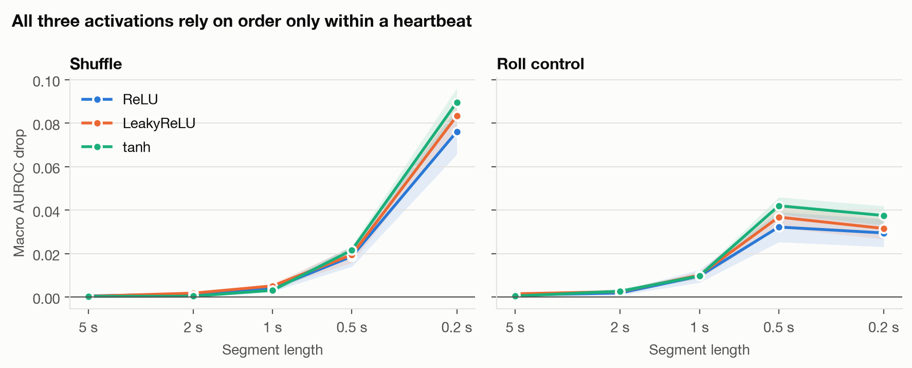
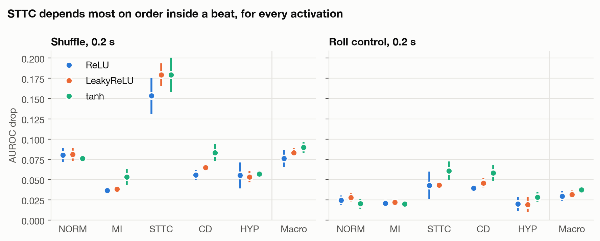

## In short

We trained the same ECG model three times, changing only one part: the **activation function**. The three
choices were ReLU, LeakyReLU and tanh.

- **ReLU and LeakyReLU work equally well.** Both score 0.922.
- **tanh is a little worse.** It scores 0.919 and learns more slowly at the start.
- **All three learn the same thing.** They rely on the shape of each heartbeat, not on the order of beats.

**Bottom line:** keep ReLU. LeakyReLU gives no benefit here, and tanh costs a little accuracy.

## 1. What we tested

**The task.** The model reads a 10-second, 12-lead ECG from the PTB-XL dataset and answers five yes/no
questions: is the ECG normal (NORM), does it show a heart attack (MI), ST/T changes (STTC), a conduction
problem (CD) or thickened heart muscle (HYP)?

**The model.** A 1D ResNet, a common type of neural network for signals. It has 17 places where it applies
an activation function. An activation function decides what each part of the network passes on:

| Activation | What it does with a value |
|---|---|
| **ReLU** | Keeps positive values, turns negative values into 0 |
| **LeakyReLU** | Keeps positive values, shrinks negative values to 1% instead of 0 |
| **tanh** | Squashes every value into the range −1 to 1, along a smooth S-shaped curve |

Everything else stayed the same: data, training settings, 30 passes over the data, and 3 runs per model with
different random seeds.

**How we score.** We use **AUROC**. Take one ECG that has a condition and one that doesn't. AUROC is how often
the model gives the first one a higher score. 1.0 is perfect and 0.5 is guessing. "Macro" is the average over
the five conditions.

**The shuffle test.** To see *what* each model relies on, we cut each test ECG into equal pieces, shuffle the
pieces and measure how much the score drops. A heartbeat lasts about 1 second, so:

- shuffling **1-second pieces** mixes up the order of whole beats, and
- shuffling **0.2-second pieces** breaks each beat apart.

A "control" makes the same cuts but keeps the pieces in order. This tells us how much of the drop comes from
the cuts themselves rather than from losing the order.

## 2. Accuracy

| Condition | ReLU | LeakyReLU | tanh |
|---|---|---|---|
| NORM | 0.944 | 0.944 | 0.943 |
| MI | 0.922 | 0.919 | 0.916 |
| STTC | 0.932 | 0.934 | 0.933 |
| CD | 0.916 | 0.916 | 0.915 |
| HYP | 0.896 | 0.895 | 0.890 |
| **Macro** | **0.922 ± 0.001** | **0.922 ± 0.002** | **0.919 ± 0.002** |

- **LeakyReLU is the same as ReLU.** No condition differs by more than 0.003, which is about how much the
  score moves between runs anyway.
- **tanh is 0.003 lower overall,** mostly on MI and HYP (0.006 lower on each). The gap is small but
  consistent: every tanh run scored below every ReLU run on the validation set.

**Why doesn't LeakyReLU help?** LeakyReLU was invented to fix a ReLU problem: parts of a network can get stuck
outputting 0 and stop learning. But this model already rescales its values (batch normalization) before every
activation, which mostly prevents that problem. So there is little for LeakyReLU to fix.

## 3. Training

All three models reach almost the same training loss. The difference is in the validation score:

- **tanh starts slower.** In the first 10 passes its validation score is clearly behind the other two.
- **All three peak around pass 15–20** (best pass on average: ReLU 16.7, LeakyReLU 18.0, tanh 18.3) and then
  get slightly worse as they start to memorize the training data. We keep the best version of each.

## 4. What the models rely on

The three lines almost overlap, so all three models behave the same way:

- **Shuffling whole beats barely matters.** With 1-second pieces the score drops by only 0.003–0.005.
- **Breaking beats apart matters a lot.** With 0.2-second pieces the score drops by 0.08–0.09, much more than
  the control (0.03–0.04).

So every model looks at the **shape inside each heartbeat**, not at the rhythm between beats.

**ST/T changes (STTC) are hit hardest in every model** (a drop of 0.15–0.18). That makes sense: spotting an
ST/T change means knowing what comes right after the main spike of the beat, which is exactly what shuffling
destroys.

LeakyReLU and tanh are slightly *more* affected by 0.2-second shuffling than ReLU (0.083 and 0.090 vs 0.076).
That gap is about the size of the run-to-run spread, so with only 3 runs we can't be sure it is real.

| | ReLU | LeakyReLU | tanh |
|---|---|---|---|
| Drop, 1-second shuffle | 0.004 | 0.005 | 0.003 |
| Drop, 0.2-second shuffle | 0.076 | 0.083 | 0.090 |
| Drop, 0.2-second control | 0.030 | 0.032 | 0.038 |
| Effect of order inside a beat (shuffle − control) | 0.047 | 0.052 | 0.052 |
| STTC drop, 0.2-second shuffle | 0.153 | 0.179 | 0.179 |

## 5. Conclusion

| Question | Answer |
|---|---|
| Does LeakyReLU improve accuracy? | No, it ties with ReLU. |
| Does tanh improve accuracy? | No, it is slightly worse (−0.003) and learns more slowly at first. |
| Does the activation change what the model relies on? | No. All three use beat shape, not beat order. |
| Which should we use? | ReLU: the simplest choice, and as accurate as either alternative. |

**Limits.** Each model was trained only 3 times, so small differences (under about 0.005) may be noise. We
tested one model design at one recording rate (100 samples per second), with the default LeakyReLU setting
(1%). A bigger LeakyReLU setting such as 10% could behave differently.

**Where to find everything.**

- Settings: `configs/leaky_relu.yaml`, `configs/tanh.yaml`
- Results: `runs/resnet1d_leaky_relu/`, `runs/resnet1d_tanh/`
- All numbers in one table: `figures/activation_metrics.csv`
- Figures: made by `scripts/plot_results.py`
- Cluster logs: `logs/train_leaky_relu_11184009.log`, `logs/train_tanh_11184010.log`
